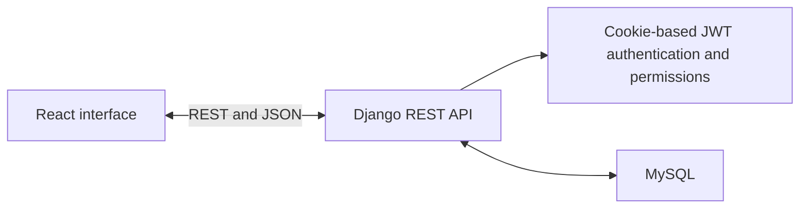

> Private portfolio draft. Public release is on hold pending owner and client approval.

# System architecture

- **Frontend.** React Router organizes project, document, account, and administrator screens. A shared API module handles credentialed requests and sends a CSRF token on applicable requests. Stylesheets include responsive layouts.
- **API and access control.** Django REST Framework provides endpoints for project tracking, documents, notifications, profiles, and account management. The backend reads JWTs from cookies and applies authentication and administrator permissions on protected endpoints.
- **Data and validation.** Django models back application data in MySQL. The API validates inputs and returns distinct responses for invalid requests, missing records, and upstream failures.
